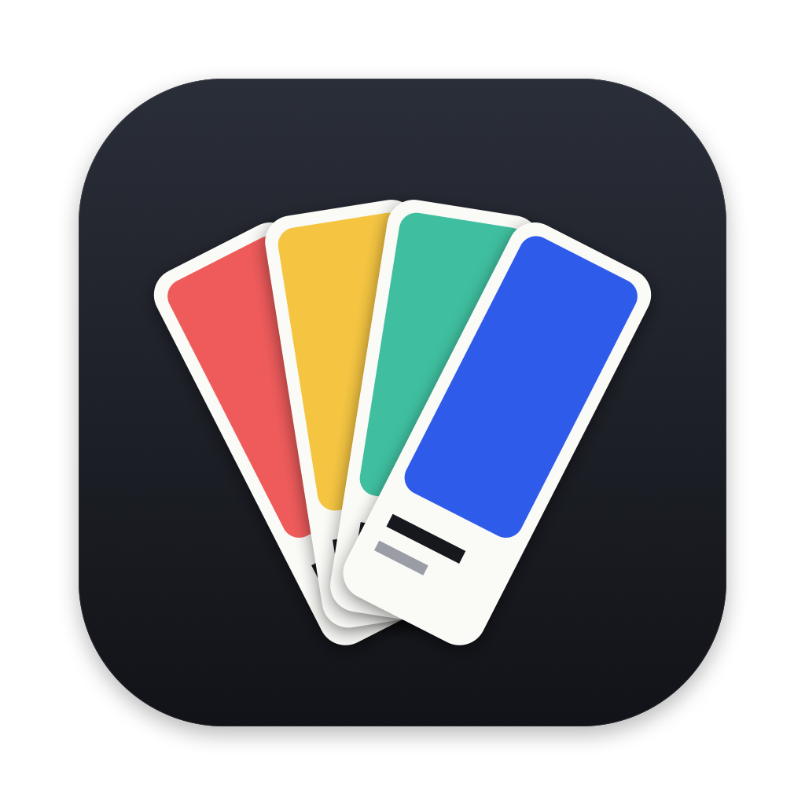
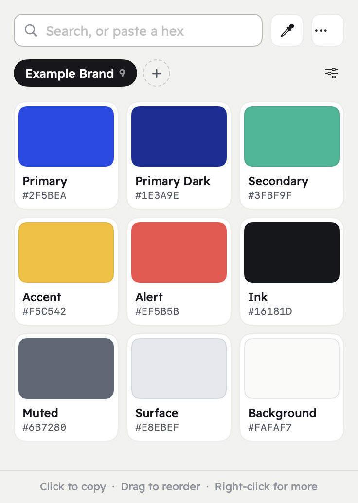
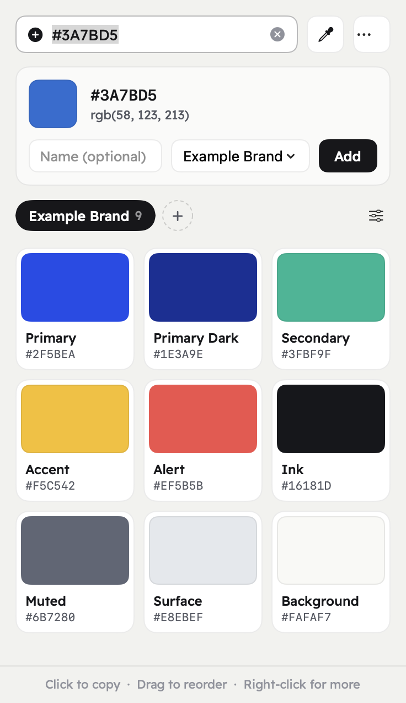
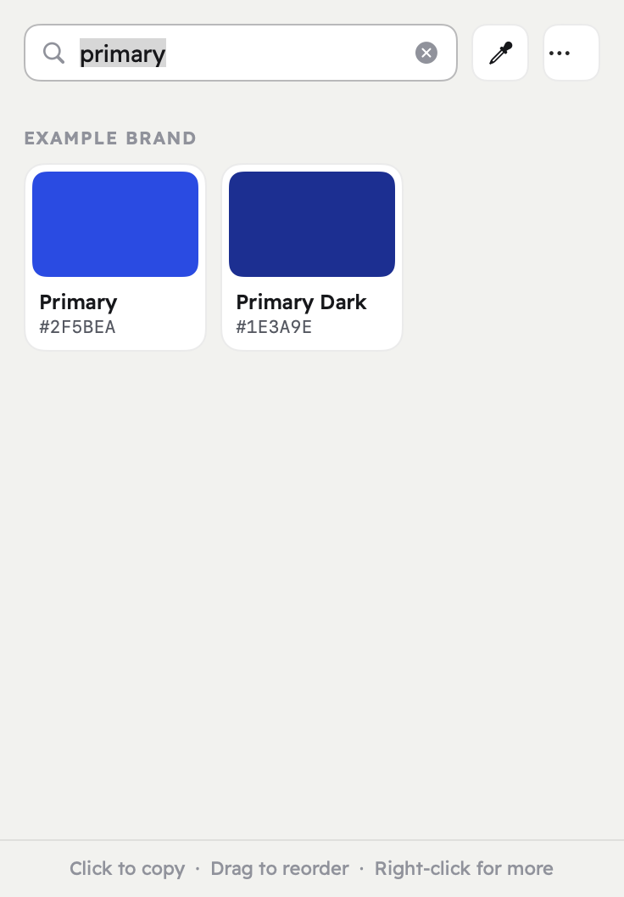

<p align="center">
  
</p>

<h1 align="center">HexBar</h1>

<p align="center">Your brand colors, one click away in the macOS menu bar.</p>

<p align="center">
  
  &nbsp;
  
</p>

## Why HexBar

If you design, build or market for a brand, you use the same few colors every day. HexBar keeps them in named palettes in your menu bar. Open it, click a color, and paste it into Figma, your code, a slide or a doc.

## Features

- **Copy with one click.** Choose the format: `#2F5BEA`, `2F5BEA` or `rgb(47, 91, 234)`.
- **Search everything.** Type a name or part of a hex code. Press Return to copy the first match.
- **Save colors fast.** Paste a hex code or pick a color from anywhere on the screen. HexBar tells you if the color is already saved.
- **One palette per brand.** Make palettes for brands, clients or projects. Drag colors to reorder them, or drop a color on a tab to move it.
- **Export a palette.** Copy a whole palette as CSS variables or as a list of hex codes.
- **Your data stays local.** Palettes are saved in a plain JSON file on your Mac.

## Install

You need macOS 14 Sonoma or later and Xcode 16 or later.

```bash
git clone https://github.com/saiafgamal/HexBar.git
cd HexBar
./script/build.sh
```

The script builds HexBar, installs it in `/Applications` and opens it. Look for the swatch icon in the menu bar. To start HexBar when you log in, open the `…` menu and turn on **Open at login**.

## How to use it

| To do this | Do this |
| --- | --- |
| Copy a color | Click it |
| Copy in a different format | Right-click it |
| Add a color | Paste or type a hex code in the field, then press Return |
| Pick a color from the screen | Click the eyedropper |
| Edit or delete a color | Right-click it |
| Move a color to another palette | Drag it onto that palette's tab |
| Make a palette | Click **+** next to the tabs |
| Rename a palette | Double-click its tab |
| Change the default copy format | Open the `…` menu |

HexBar starts with one example brand palette. Rename it, edit it, or delete it.

<p align="center">
  
</p>

## Your data

Palettes are saved here:

```
~/Library/Application Support/HexBar/palettes.json
```

You can back up this file, sync it, or edit it by hand. To find it, open the `…` menu and choose **Show palettes file**.

## Development

- `./script/build.sh` builds a release version and installs it.
- `HexBar.app/Contents/MacOS/HexBar --snapshot <folder>` renders the main screens to PNG files. It does not touch your data.
- `swift script/make-icon.swift` draws the app icon again.

Contributions are welcome. Open an issue or a pull request.

## Credits

Interface font: [Readex Pro](https://fonts.google.com/specimen/Readex+Pro), SIL Open Font License (`Resources/ReadexPro-OFL.txt`).

## License

[MIT](LICENSE)
